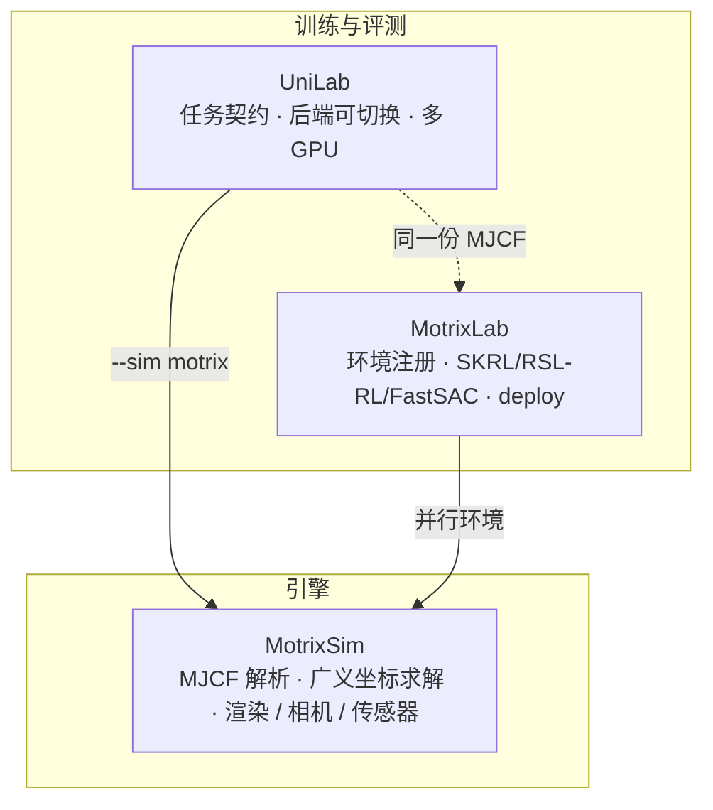

# MotrixSim / MotrixLab / UniLab 技术分享

> 面向"想把一台机器人塞进仿真、跑起来、再接上训练或 ROS2"的工程师。
> 以一台自制的麦轮网球机器人为例，全部数字都是本项目实测。
> 环境：Ubuntu 24.04 + Python 3.12 + `motrixsim 0.10.1`。

---

## 1. 三个东西分别是什么

Motphys 的产品可以按"引擎 → 训练框架 → 训练基础设施"三层理解：

| 产品 | 定位 | 谁用 | 关键点 |
|---|---|---|---|
| **MotrixSim** | 物理仿真引擎（Python 包 + 交互式渲染器） | 所有人都要用 | 广义坐标多体动力学、自研约束/求解器、CPU 后端用 Rust 写、高度兼容 MJCF、`pip install` 即可 |
| **MotrixLab** | 建在 MotrixSim 上的强化学习框架 | 做 RL 训练的人 | 一套环境定义、SKRL/RSL-RL/内置 FastSAC 训练、上千并行环境、`mxlab train` 一条命令、策略可部署到 MuJoCo/真机 |
| **UniLab** | 跨物理后端的机器人学习基础设施 | 要多后端对比/大规模训练的人 | Hydra 配置驱动的任务契约，`--sim motrix` 或 `--sim mujoco/mjwarp/genesis/newton/isaacgym` 切后端不改任务代码，CPU 仿真喂 GPU learner（CoRL 2026） |



三者共享同一条主线：**MJCF 描述的机器人和场景**。同一份 XML 既能拿 `motrixsim` 直接 `load_model` 做工程验证，也能被 UniLab 当成 `motrix` 后端批量 rollout，还能在 MotrixLab 里注册成一个训练任务。所以**先把 MJCF 做对**，是三个场景共同的投入。

---

## 2. 一句话对比：为什么不用 MuJoCo

不是替代关系，而是各有取舍：

| 维度 | MotrixSim | MuJoCo |
|---|---|---|
| 安装 | `pip install motrixsim`（含 core，无 CMake） | `pip install mujoco` |
| 模型格式 | MJCF（兼容主流子集，含 `<adhesion>`、SDF、hfield、mocap） | MJCF 原生 |
| 语言/后端 | Rust CPU 后端 + Python API | C + Python 绑定 |
| 自带渲染 | 有交互式渲染器（窗口/无窗口、离屏相机、widgets、gizmos） | 需 `mujoco.viewer` 或额外渲染 |
| 并行/批量 | `SceneData` 带 batch 维度，渲染器 `launch(model, batch=N)` | 单实例为主 |
| 内置控制器 | `motrixsim.ik` / `motrixsim.osc` / `motrixsim.coacd`（凸分解） | 需自己写 |
| RL 生态 | MotrixLab / UniLab 直接支持 | 生态最大（gymnasium、各种 wrapper） |

实际体感：**MJCF 怎么写、body/joint/geom 怎么组织几乎一样**，把已有 MuJoCo 模型迁过来主要是校对属性名和少数扩展标签；换来的是开箱的渲染器、相机和批量接口。

---

## 3. MotrixSim 上手（10 行跑起来）

```bash
uv venv --python 3.12 .venv
uv pip install --python .venv/bin/python motrixsim pyyaml
```

```python
import motrixsim

model = motrixsim.load_model("rally_court.xml")   # MJCF 文件路径
data = motrixsim.SceneData(model)                 # 仿真状态
model.forward_kinematic(data)                     # 必须先算一次，否则 link poses 全是 0

for _ in range(500):                              # 500 × 0.002 s = 1 s
    motrixsim.step(model, data)                   # 或 model.step(data)

print(model.options.timestep)                     # 0.002 -> 500 Hz
print(model.link_names[:3], model.num_dof_pos)    # 42 links, 54 dofs
```

要能动起来，只需要设置**执行器控制量**——顺序与 MJCF 里 `<actuator>` 一致：

```python
data.actuator_ctrls = [0.0, 0.0, 0.0, 0.0]        # 4 个 <motor>，单位 N·m
```

> 注意：`<motor>` 的 ctrl 是**力矩**，不是速度。想要"轮子转到 5 rad/s"，得自己写速度伺服（见 §5.3）。

---

## 4. API 地图

`SceneModel` = 静态模型，`SceneData` = 动态状态，`motrixsim.step()` = 推进。日常只用这三样。

### 4.1 模型侧

| 用途 | API |
|---|---|
| 名字表 | `model.link_names` / `body_names` / `joint_names` / `geom_names` / `site_names` / `actuator_names` |
| 按名取对象 | `model.get_body/get_joint/get_geom/get_site/get_actuator(name)` |
| 计数 | `num_links` / `num_joints` / `num_geoms` / `num_sensors` / `num_actuators` |
| DoF 布局 | `model.joint_dof_pos_indices` / `joint_dof_pos_nums`（free joint 占 7 个位置）|
| 选项 | `model.options.timestep` / `gravity` / `max_iterations` / `solver_tolerance` / `disable_gravity` |

### 4.2 状态侧

| 用途 | API |
|---|---|
| 位置 | `data.dof_pos`（`[free base: x,y,z,qx,qy,qz,qw] + 各 joint`）|
| 速度 | `data.dof_vel` |
| 写状态 | `data.set_dof_pos(values, model)` / `data.set_dof_vel(values)` |
| 控制 | `data.actuator_ctrls`（读用 `model.get_actuator_ctrls(data)`）|
| 重置 | `data.reset(model)` |

### 4.3 查询（每步后读）

| 用途 | API |
|---|---|
| 位姿 | `model.get_link_poses(data)` → `(num_links, 7)`，**四元数在最后：`[x,y,z,i,j,k,w]`** |
| 速度 | `model.get_link_velocities(data)` |
| 传感器 | `model.get_sensor_value(name, data)` / `get_sensor_values(data)` |
| 相机 | `model.get_camera_poses(data)` |
| 几何包围盒 | `model.get_geom(name).get_world_aabb(data)` |

### 4.4 渲染

```python
import motrixsim.render as mr

with mr.RenderApp(headless=False, fps=60) as app:
    app.launch(model)                    # 还有 batch= / render_offset= 可以做多环境拼图
    cam = app.system_camera
    cam.set_view(lookat=(-11.885, 0, 0.15), distance=2.4, elevation=-22, azimuth=120)
    while True:
        for _ in range(8):               # 60 fps 下每帧推进 8 × 0.002 s
            model.step(data)
        app.sync(data)                   # 把状态刷到渲染器
```

离屏取图（做数据采集/CI 验证非常有用）：

```python
render_cam = app.get_camera(0)           # 对应 MJCF 的第 0 个 <camera>
task = render_cam.capture()              # 异步
img = task.take_image()                  # 还没好之前返回 None
if img is not None:
    img.save_to_disk("view.png")
```

---

## 5. 实战：一台麦轮网球机器人

场景来自 Isaac 的 `RallyCourt.usd`（网球场地 + 麦轮车），最终在 MotrixSim 里做到：**4 路执行器、36 个麦轮辊子、2 台相机、IMU、ROS2 速度控制、120 Hz 数据发布**。

规模：`42 links / 40 joints / 251 geoms / 54 dof_pos / 4 motors / 36 辊子关节 / 2 cameras / 10 sensors`。

### 5.1 用生成器写 MJCF，不要手改

模型是脚本生成的（`gen_mjcf.py`），不是手写 XML。好处在这次迭代里非常具体：

```python
CAGE_S = 0.8                      # 整个网笼缩到 0.8 倍
NET_HALF = 0.26 * CAGE_S          # 0.208
POST_TOP_Z = DECK_TOP + NET_WALL_H
```

改一个参数 → 重跑生成器 → 三份 XML 同步更新（单体、场地版、Blender 导入版）。手改 XML 的问题在于：**同一份几何出现在多个地方**（视觉 mesh、碰撞 box、inertial、site），改漏一处就会出现"看着对、撞起来错"。

> 特别提醒：如果走 Blender（Forge addon）导出的路线，导出器对**碰撞体的局部变换**有过 bug（导出的 collider 偏位）。我们在结构性改动上统一走生成器，Blender 只用来做可视检查。

### 5.2 传感器要在 MJCF 里声明

MotrixSim 直接支持 MJCF 的传感器族，IMU 就是三类 sensor 的组合：

```xml
<site name="imu" pos="0 0 0" size="0.01"/>
...
<sensor>
  <accelerometer site="imu" name="imu_acc"/>     <!-- 线加速度（含重力，静止 +9.81） -->
  <gyro          site="imu" name="imu_gyro"/>     <!-- 角速度（局部系） -->
  <framequat objtype="site" objname="imu" name="imu_quat"/>
  <frameangvel objtype="body" objname="base" name="base_angvel_world"/>
  <jointvel joint="FL_wheel_joint" name="FL_wheel_vel"/>
</sensor>
```

```python
acc = model.get_sensor_value("imu_acc", data)      # 静止：(0, 0, +9.81)
```

**符号坑**：MuJoCo/MotrixSim 的加速度计输出是"比力的反号"——静止读 `+9.81`；而 ROS 的 `sensor_msgs/Imu`（REP-145）要求静止是 `-9.81`。发布前记得三轴取反，不然 RViz 里重力方向是反的。

### 5.3 轮子速度伺服 + 麦轮解算（实测标定）

`<motor>` 给的是力矩，速度控制要闭环：

```python
w      = np.array([j.get_dof_vel(data)[0] for j in wheels])   # 实测轮速
ctrl   = np.clip(KP * (targets - w), -12, 12)                 # 力矩限幅 ±12 N·m
data.actuator_ctrls = ctrl
```

麦轮解算的增益**不要照抄几何公式**，直接在模型上测：给四个轮子同样的 5 rad/s，量车身速度。

| 输入（每轮 rad/s） | 实测车身 | 标定增益 |
|---|---|---|
| `(5, 5, 5, 5)` | 车身 −X 0.4979 m/s | 0.09958 m/s per rad/s |
| `(−5, 5, 5, −5)` | 车身 +Y 0.4856 m/s | 0.09712 m/s per rad/s |
| `(5, −5, 5, −5)` | 偏航 +0.9307 rad/s | 0.18613 rad/s per rad/s |

交叉耦合很小（串扰 < 0.4%），所以解算可以写成干净的三项和：

```python
FL = c + l + y;  FR = c - l - y;  RL = c - l + y;  RR = c + l - y
# c = -vx/G_FORE, l = vy/G_LAT, y = wz/G_YAW
```

再加一层车身速度比例修正（`kp=0.3`），实测精度：命令 0.4 m/s 走 2 s → 0.802 m（理论 0.80）；命令 0.8 rad/s 转 1 s → 45.7°（理论 45.8°）。

### 5.4 相机迁移（从 USD 抄参数）

原场景的两台单目相机只有 `pos/quat/lens`，参数要靠换算：

```
lens 390 mm + sensor 570.24×427.68 mm  ->  HFOV 72.34° / VFOV 57.47°
```

MJCF 里用 `fovy` + `xyaxes` 表达朝向（比 `quat` 可读）：

```xml
<camera name="LeftCam" pos="0.20 -0.19 0.21" xyaxes="-1 0 0 0 0 1" fovy="57.47"/>
```

`xyaxes` 的前三个数是相机 **X 轴**、后三个是 **Y 轴**，相机看向 **−Z**、上为 **+Y**。验证方式不是看图，是算：

```python
poses = model.get_camera_poses(data)
# 取四元数转 R，检查 R @ [0,0,-1] 是否等于期望视线方向
# 实测：view=(1,0,0) 朝球网、up=(0,0,1)
```

### 5.5 ROS2 桥接：一个进程搞定

不搞 Isaac 那种 OmniGraph 节点图，MotrixSim 里直接"物理循环 + ROS 循环"同线程：

```python
while rclpy.ok():
    rclpy.spin_once(node, timeout_sec=0.0)            # 收 cmd_vel
    while sim_time < wall_elapsed:                     # 按实时率推进
        model.step(data)
        if sim_time >= pub_next:                       # 120 Hz 发布
            publish_all()
            pub_next += 1 / 120
    app.sync(data)                                     # 有窗口时才刷
```

设计要点：

- **时间戳用仿真时间**，与 `/clock` 一致，下游 `use_sim_time` 才对得上；
- **deadman 用仿真时间**算（0.5 s 无消息停车），暂停仿真时不会误触发；
- 传感器数据全部走模型内 sensor，不自己差分（`framequat` 比"位姿差分"稳得多）；
- 帧率 != 物理频率：物理 500 Hz、渲染 60 Hz、发布 120 Hz，三个独立累加器。

实测：`/imu/data_raw` 119.6–122.4 Hz、静止 `(0, 0, −9.810)`；`/odom` 静止漂移 µm 级；`cmd_vel` 前后左右和自转方向全部对得上。

---

## 6. 踩坑清单（都是这次真踩的）

| # | 现象 | 原因 | 解法 |
|---|---|---|---|
| 1 | 读出来的姿态角完全不对 | `get_link_poses` 的四元数是 `[x,y,z,i,j,k,w]`，**w 在最后**（MJCF 里是 `w x y z`） | 统一按 `(i,j,k,w)` 处理，转换函数只写一处 |
| 2 | 改了 `data.dof_pos[:7]` 没反应 | 属性返回的是拷贝，就地写不回写 | 用 `data.set_dof_pos(values, model)`（注意第二个参数是 model）|
| 3 | 拿到的 link 位姿全是 0 | 建完 `SceneData` 没算正向运动学 | 第一步先 `model.forward_kinematic(data)` |
| 4 | 取到的是球不是机器人 | `links[-1]` 不保证是 base | 一律 `link_names.index("base")` 按名找 |
| 5 | IMU 静止 Z 是 +9.81 | 加速度计是比力约定（与 ROS 反号） | 发布前取反 |
| 6 | 车轮越白线抖一下 | 白线是 `contype=0` 视觉体，不参与碰撞；真正的坎在**球场和绿地的接缝**：两个碰撞体顶面差 1 mm，而底线正好画在接缝上 | 视觉体保留 1 mm 落差避免 z-fighting，碰撞只留**一整块平板** |
| 7 | 球场上出现闪烁的接缝 | 两个共面视觉盒 | 绿色地面下沉 1 mm |
| 8 | 相机拍到自己/看不见车 | 近裁剪 + `elevation` 符号（负值才是从上方看） | 用 `set_view(dist/lookat)` 先定位，再算 `get_camera_poses` 校验 |
| 9 | 轮子转但车不动 | 用几何公式算的轮速增益偏 12% | 在模型上实测标定（§5.3）|
| 10 | 同一份几何改一处对、撞起来错 | 视觉/碰撞/inertial 各存一份 | 生成器统一产出，禁止手改 |

---

## 7. 性能与工程建议

| 建议 | 理由 |
|---|---|
| 物理 `dt=0.002`（500 Hz），渲染 60 Hz | 36 个辊子的小惯量需要高频积分，否则接触发散；渲染不必跟着 500 Hz |
| 发布频率单独限流（120 Hz） | ROS 侧 500 Hz 桥接会拖垮 Python 回调 |
| 传感器读值，不做数值差分 | `framequat`/`gyro`/`accelerometer` 都是解析量，差分噪声大一个量级 |
| 结构性改动走生成器 | 视觉/碰撞/inertial 三份数据必须同步 |
| 验证优先用数字 | 位置、速度、包围盒、姿态四元数都能断言；截图只作辅助 |

实测驱动指标（同一模型，静止起步）：

| 指标 | 实测 | 规格 |
|---|---|---|
| 车身 X 最高速 | 4.01 m/s | 4.0 |
| 车身 Y 最高速 | 4.38 m/s | 4.5 |
| 加速 | 3.43 / 2.51 m/s² | 3.5 / 2.5 |
| 减速 | 5.13 / 4.96 m/s² | 5.0 |

---

## 8. 从"能跑"到"能训练"

这台车现在具备三件训练必需的东西：

1. **执行器接口**：`data.actuator_ctrls`（4 个电机力矩）——这是 RL 的 action 空间；
2. **观测**：车身速度、IMU 六轴、四个轮速、相机位姿；
3. **预留的轮子直控通道**：ROS 侧有 `/mecanum/wheel_cmd`（4 个轮速目标，rad/s），不用经过麦轮解算——将来策略直接输出四个轮子转速也能直接注入。

往上接哪一层：

| 需求 | 选型 |
|---|---|
| 就想训一个策略、要现成环境模板 | **MotrixLab**：`mxlab train task=.../motrix.fastsac`，上千并行环境、SKRL/RSL-RL/FastSAC，训完 `deploy` 到 MuJoCo/真机 |
| 要跨仿真器对比、要 CPU 仿真 + GPU 训练 | **UniLab**：`--sim motrix` / `--sim mujoco` 切后端不改任务，Hydra 配置组装任务 |
| 只想验证自己的控制器/接口 | **MotrixSim** 裸用（本文 §3–§5 就是这条路）|

三条路共用同一份 MJCF——所以先把 §5 的模型做扎实，比后面写训练代码更省时间。

---

## 9. 参考

- MotrixSim 文档：https://motrixsim.readthedocs.io ｜ 模型/API 速查：https://github.com/Motphys/motrixsim-agent-docs（按版本打 tag）
- MotrixSim 仓库：https://github.com/Motphys/motrixsim
- MotrixLab：https://github.com/Motphys/MotrixLab ｜ 文档：https://motrixlab.readthedocs.io
- UniLab：https://github.com/Motphys/UniLab ｜ 文档：https://unilabsim.github.io/UniLab-doc/
- 本项目产物：`gen_mjcf.py`（模型生成）、`motion.py`（驱动）、`ros2_bridge.py`（ROS2 桥接）、`test_motion.py`（指标回归）
